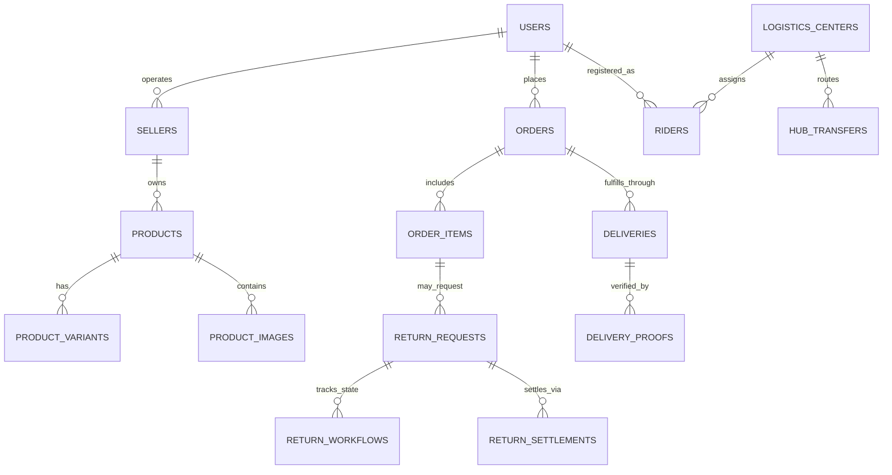

# INVOIZ System Architecture

This document describes the high-level architecture, subsystem boundaries, data models, authentication mechanisms, and infrastructure design for the **INVOIZ** multi-role e-commerce, logistics, and escrow platform.

---

## 1. System Overview

INVOIZ is an integrated end-to-end multi-vendor marketplace with built-in logistics operations and reverse-fulfillment (returns) management. The platform unites four operational domains under a unified database and core backend service layer:

```
                                 +-------------------------------------------------+
                                 |                   INVOIZ                       |
                                 |         Single Shared Laravel Backend          |
                                 +-------------------------------------------------+
                                       ^            ^            ^            ^
                                       |            |            |            |
                                       v            v            v            v
+------------------------+  +-------------------+  +-------------------+  +------------------------+
|      BUYER DOMAIN      |  |   SELLER DOMAIN   |  |  LOGISTICS DOMAIN |  |      ADMIN DOMAIN      |
+------------------------+  +-------------------+  +-------------------+  +------------------------+
| - Web Storefront (PHP) |  | - Seller Center   |  | - Logistics Hub   |  | - Superadmin Console   |
| - Buyer Mobile (Flutter|  | - Product Catalog |  |   Operations Web  |  | - User Approvals       |
| - Cart & Checkout      |  | - Order Mgmt      |  | - Rider Mobile    |  | - Seller & Hub Approvals|
| - Escrow & Refunds     |  | - Store Vouchers  |  |   (Flutter App)   |  | - Escrow & Settlements |
| - Buyer-Seller Chat    |  | - Returns Review  |  | - Hub Transfers   |  | - Disputes & Policies  |
+------------------------+  +-------------------+  +-------------------+  +------------------------+
```

---

## 2. Core Operational Domains & User Roles

All actors authenticate against a single shared `users` table, distinguished by role flags, approval statuses, and linked profile records:

| Role Identifier | Description | Interfaces | Core Capabilities |
| :--- | :--- | :--- | :--- |
| **Buyer** (`buyer`) | Consumer purchasing products on the marketplace. | Web Storefront (`/`, `/shop`), Flutter App (`buyer_mobile`) | Search & browse products, manage cart, place orders, make COD/GCash escrow payments, track delivery, request returns/refunds, chat with sellers. |
| **Seller** (`seller`) | Merchant selling goods across categories. | Seller Center Web (`/seller/*`) | Manage catalog (dimensions, weights, variants, gallery images), manage inventory, fulfill orders, handle returns (including keep-item direct refunds), configure vouchers. |
| **Logistics Staff / Hub Manager** (`logistics_staff`, `logistics_admin`) | Operations staff at distribution hubs. | Logistics Portal Web (`/logistics/*`) | Dispatch packages, manage sorting hubs, oversee transfer trips between hubs, assign riders/drivers, audit proof of delivery. |
| **Rider / Driver** (`rider`, `hub_transport_driver`) | Last-mile courier or inter-hub transport driver. | Flutter App (`rider_mobile`), Web driver screens | View assigned pickups and deliveries, optimize route, scan package barcodes, upload proof of delivery (photo/signature), manage COD remittance, process return pickups. |
| **Admin** (`admin`, `superadmin`) | Platform operator and regulatory authority. | Admin Dashboard Web (`/admin/*`) | Approve seller applications, audit rider documents, manage logistics center licenses, handle payment disputes, oversee escrow releases and commission rates. |

---

## 3. Technology Stack

### Backend & Server Architecture
* **Framework**: Laravel 11.x (PHP 8.2+)
* **Database**: MySQL 8.0+ (Production & Staging), SQLite (Automated unit/isolated testing)
* **ORM**: Eloquent ORM with strict foreign keys and transactional guarantees
* **Authentication**: 
  * Stateful Session Authentication (`web` guard) for browser portals (Buyer, Seller, Admin, Logistics Web).
  * Stateless Bearer Token Authentication (Laravel Sanctum) for Flutter mobile apps (`buyer_mobile`, `rider_mobile`).
  * Email OTP 6-digit verification with throttling and expiry enforcement.
* **File Storage**: Local filesystem disk (`storage/app/public`) organized into structured directories (`products/`, `returns/`, `proofs/`, `deliveries/`, `avatars/`).

### Frontend Web Portals
* **Templating**: Laravel Blade with shared layout components
* **Styling**: Tailwind CSS & modular stylesheets (`public/assets/shared/css/`, `public/assets/buyer/css/`)
* **Asset Bundler**: Vite (`resources/js`, `resources/css`)
* **Interactive UI**: Alpine.js, Vanilla ES6+ modules (interactive galleries, touch swipe handlers, live modals)

### Mobile Clients
* **Framework**: Flutter 3.x / Dart
* **Buyer App** (`buyer_mobile`): 18+ native screens covering complete consumer lifecycle, available as Android APK and browser web preview (`/buyer-app/`).
* **Rider App** (`rider_mobile`): Native courier app with real-time delivery job queue, barcode/QR scanner, camera capture for proof of delivery, and offline-tolerant state.

---

## 4. Database Schema & Entity Relationships

The database is unified under a single relational schema. Key entity groups include:



### Key Models & Their Responsibilities
1. **User Identity & Access**:
   * `User`: Central authentication record containing credentials, role flags, OTP tokens, email verification, and suspension status.
   * `Seller`: Business profile, store name, slug, verification status, contact details, store rating.
   * `Rider`: Courier profile, vehicle type, license documents, assigned logistics center, duty status.
   * `LogisticsCenter`: Physical distribution hub with geographical coordinates, service areas, and assigned staff.

2. **Commerce & Inventory**:
   * `Product`: Storefront item with name, SKU, price, stock, category, actual weight (kg), package dimensions (Length, Width, Height in cm), and sale status.
   * `ProductVariant`: SKU variations (color, size, model) with price adjustments and individual stock levels.
   * `ProductImage`: Multi-image gallery with display ordering.
   * `Voucher`: Store-wide or seller-specific discount codes with claim limits and minimum spend rules.

3. **Order Lifecycle & Escrow**:
   * `Order`: Root transaction linking buyer, items, shipping address, payment method, voucher discounts, and fulfillment status.
   * `OrderItem`: Line item snapshotting product title, unit price, quantity, and seller attribution.
   * `Payment`: Transaction record tracking payment provider (COD, GCash), status, escrow hold, and disbursement.

4. **Logistics & Reverse Logistics**:
   * `Delivery`: Shipping assignment linking order items to a dispatch hub and courier rider.
   * `DeliveryProof`: Photographic evidence and buyer signature collected at the delivery point.
   * `HubTransfer`: Bulk shipment movements between regional logistics centers.
   * `ReturnRequest`: Buyer return/refund dispute record with evidence images/videos and pro-rated refund calculations.
   * `ReturnWorkflow`: Audit trail and state transition engine for reverse logistics.
   * `ReturnSettlement`: Financial resolution tracking (Keep-Item Direct Refund, Escrow Reversal, or Seller Payout Adjustment).

---

## 5. Security & Authentication Architecture

1. **Unified Authentication Boundary**:
   * All API requests from mobile applications validate Bearer tokens using Laravel Sanctum.
   * Web requests enforce CSRF protection via standard Laravel tokens.
   * Inactive, suspended, or unapproved accounts are rejected at the middleware boundary (`ActiveAccountMiddleware`).

2. **Role & Resource Isolation**:
   * `SellerMiddleware`: Restricts seller portal endpoints to users with active, approved seller profiles. Ensures sellers can only read and mutate their own products, orders, and returns.
   * `LogisticsMiddleware`: Protects hub operations, dispatch tables, and driver manifests.
   * `AdminMiddleware`: Enforces administrative privileges for platform configurations and user reviews.

3. **Escrow & Financial Safety**:
   * Payments remain held in escrow until the buyer confirms receipt or the order status updates to `delivered` and the return window passes without dispute.
   * Direct refunds enforce atomic database transactions (`DB::transaction`) to ensure stock restoration and wallet adjustments are strictly consistent.

4. **Safe File Uploads**:
   * Evidence media (return dispute proofs, delivery sign-offs, KYC identity files) are strictly validated for allowed MIME types (`image/jpeg`, `image/png`, `video/mp4`) and maximum size constraints (up to 50MB for video evidence).
