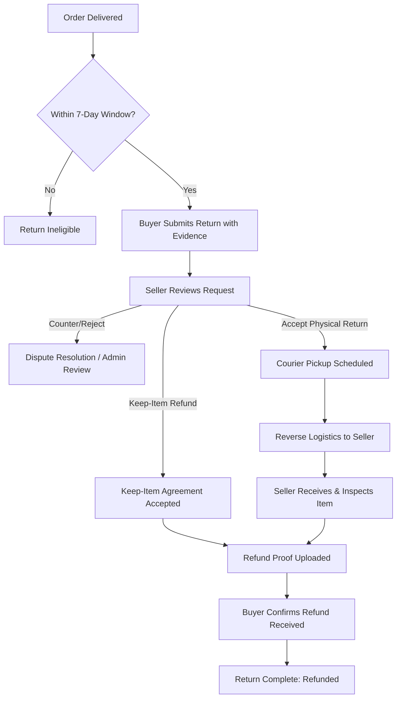

# INVOIZ Core Business Workflows

This document outlines the core business workflows powering the INVOIZ marketplace, logistics, and reverse-fulfillment ecosystem.

---

## 1. Order Lifecycle & Escrow Settlement

Every customer transaction passes through strict state transitions designed to ensure buyer protection, inventory accuracy, and guaranteed seller payouts:

```
[Buyer Places Order] ---> [Payment Held in Escrow] ---> [Seller Packs Order]
                                                                |
                                                                v
[Buyer Confirms / Window Passes] <--- [Rider Delivers] <--- [Courier Pickup & Transit]
              |
              v
[Escrow Released to Seller]
```

### Stage 1: Checkout & Voucher Calculation
* **Cart or Buy Now**: Buyers can purchase items individually or group items across multiple sellers.
* **Vouchers**: Vouchers can apply store-wide or to specific sellers. Seller-scoped vouchers discount the subtotal exclusively for that seller's line items.
* **Payment Methods**:
  * **Cash on Delivery (COD)**: Payment collected by the delivery rider upon physical handover.
  * **GCash Escrow**: Direct electronic payment verified via reference code or receipt upload, held in platform escrow until delivery satisfaction.

### Stage 2: Fulfillment & Logistics Handover
1. The seller marks the order as **Processing / Ready to Ship**.
2. A pickup job is dispatched to the seller's designated regional **Logistics Center**.
3. A courier rider visits the merchant to pick up the parcel and verifies its tracking number.

### Stage 3: Transit, Hub Transfer & Delivery
* Parcels travel through local sorting hubs. If destination is out-of-region, an **Inter-Hub Transfer** is created with manifest documentation.
* The assigned last-mile rider delivers the package to the buyer's shipping address.
* The rider collects mandatory **Proof of Delivery** (recipient signature and photo of package handover) before marking the order as `delivered`.

### Stage 4: Escrow Clearance
* Once delivered, the system initiates the **Return Window** countdown (default: 7 days).
* If no return or dispute is raised by the buyer within the window, the order status transitions to completed and escrowed funds are credited to the seller's balance for withdrawal.

---

## 2. Return & Refund Workflow

The return/refund workflow is unified across both the **Buyer Mobile App** and the **Buyer Web Storefront**.



### Eligibility & Rules
1. **Order State**: The order item must have reached `delivered` status.
2. **Time Window**: Enforces `return_window_days` (default 7 days) from the recorded delivery timestamp.
3. **Prevent Duplicate Claims**: Cannot create overlapping return requests for items already under review.
4. **Valid Reasons**:
   * `damaged`
   * `wrong_item`
   * `not_as_described`
   * `changed_mind`
   * `ordered_wrong_size` / `ordered_wrong_color`
   * `received_wrong_size` / `received_wrong_color`
   * `other` (requires at least 10 characters in `reason_details`)
5. **Evidence**: Photo or video proof (up to 50MB) is mandatory and stored securely in `storage/app/public/returns/`.
6. **Pro-rated Refund Math**: Net refund amount automatically accounts for item quantities and pro-rates any seller discounts or vouchers used during checkout.

### Dual Resolution Paths
* **Path A: Keep-Item Refund (Direct Refund)**
  Used when returning the physical item is impractical (e.g. perishable goods, low-value items, minor cosmetic issues). The seller grants an instant refund while allowing the buyer to keep the item. No reverse shipping is charged.
* **Path B: Physical Return (Reverse Fulfillment)**
  The item is routed back to the merchant via INVOIZ logistics:
  1. `awaiting_collection`
  2. `pickup_assigned`
  3. `collected` (courier collects from buyer)
  4. `at_hub` / `in_transfer` (reverse hub sorting)
  5. `delivered_seller` (item returned to seller)
  6. `refund_pending` (seller verifies condition)

### Settlement Confirmation
Once the refund payment is transferred (e.g., GCash / bank transfer), the payment receipt is uploaded:
* The buyer reviews the transaction reference and slip on their device (Web or Mobile).
* The buyer clicks **"Confirm Refund Received"**, transitioning the return to `refunded` and closing the case.

---

## 3. Product Catalog & Volumetric Shipping

### Physical Specifications
To calculate accurate delivery fees and vehicle loading capacities, products require exact physical specifications:
* **Actual Weight**: Stored as a floating-point number in **kilograms (kg)**.
* **Dimensions**: Stored as individual fields for **Length (cm)**, **Width (cm)**, and **Height (cm)**.
* **Volumetric Weight**: Logistics services calculate volumetric weight using standard dimensions:
  $$\text{Volumetric Weight (kg)} = \frac{\text{Length (cm)} \times \text{Width (cm)} \times \text{Height (cm)}}{3500}$$
  The higher value between actual weight and volumetric weight determines the shipping bracket.

### Product Presentation & Swiping Carousel
* **Multi-Image Support**: Sellers upload multiple product angles stored in `product_images`.
* **Responsive Gallery**: 
  * Mobile & Web touch swipe gestures.
  * Aspect-ratio constrained (`1:1` square, max 440px) to prevent layout shifts.
  * Image thumbnail navigation and active index counters (`1 / N`).

---

## 4. Multi-Hub Logistics Network

```
+------------------+         Inter-Hub Trip         +------------------+
|   Origin Hub     | =============================> |  Destination Hub |
| (Sorting/Pickup) |         (Heavy Truck)          |   (Last-Mile)    |
+------------------+                                +------------------+
        ^                                                    |
        | Pickup Courier                                     | Delivery Rider
        |                                                    v
+------------------+                                +------------------+
|      Seller      |                                |      Buyer       |
+------------------+                                +------------------+
```

1. **Service Areas**: Each logistics center is bound to geographic regions, provinces, and barangays.
2. **Dynamic Route Assignment**: Orders are automatically routed to the nearest origin hub based on the seller's registered warehouse location.
3. **Trip Manifests**: Inter-hub line-haul drivers transport batched containers between hubs with verifiable trip logs, security seals, and digital waybills.
4. **Barcode Scanning**: Handheld mobile scanning validates package check-in and check-out at each transfer milestone.

---

## 5. Communications & Notification Channels

* **In-Platform Buyer-Seller Chat**: Real-time messaging thread scoped to specific products or orders, preventing off-platform fraud.
* **Automated Notifications**: Triggered for status transitions (Order Confirmation, Rider Out for Delivery, Delivery Succeeded, Return Requested, Refund Disbursed).
