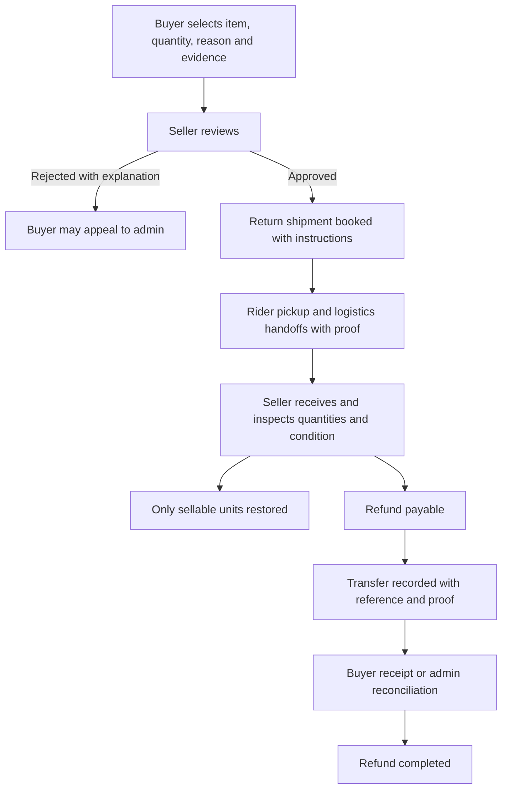

# Return and refund flow review — 29 October 2026

Scope: the current working tree, including the buyer Flutter app, buyer/seller
websites, rider API, logistics staff/admin actions, payment ledger, inventory and
marketplace admin dispute handling. This was an audit: no application behavior,
live orders, payments, inventory or seller data was changed. No commit was made.

## Current behavior

There are two independent workflows. A buyer's post-delivery return does not
create or join a logistics return shipment.

| Role | Buyer return after delivery | Failed/damaged delivery returned to seller |
| --- | --- | --- |
| Buyer | Mobile Order Details exposes Request return for delivered orders. Choose a purchased line/variation, quantity and reason. Other requires details. The server checks ownership, remaining quantity and a configurable window, default 7 days. The website has no equivalent return form or route. | Sees delivery/order information; no linked return case or automatic refund resolution. |
| Seller | Returns & Refunds lists requests. Approve or reject; after approval, Mark received & refund updates the refund ledger and restores stock. Approval tells the seller to ask the buyer to ship back. | An order's Returned Parcel section allows receipt confirmation after logistics records dispatch. Confirmation changes the delivery to returned_to_seller and restores stock. It does not issue a refund. |
| Rider | No assignment is created when the seller approves a buyer return. | Assigned rider reports failure/damage, can request a reattempt or mark returned to center. Damage reporting requires a photo. Returning to center clears a pending reattempt and preserves the failure reason. |
| Logistics staff | No buyer-return pickup queue or linked case. | Staff are restricted to their center. Send to Seller records a dispatch log and notifies the seller; it does not assign a return rider or independently verify the center received the returned parcel. |
| Logistics admin | No dedicated buyer-return process. | Can manage eligible parcel exceptions/return dispatch across centers. Lost parcels cannot be dispatched back as though physically available. |
| Marketplace admin | A payment-dispute resolution POST endpoint can record a refund for an existing dispute. Buyer return requests, support complaints and payment disputes are separate records. No connected buyer-return appeal or dispute creation/management screen was found. | Complaints can be resolved with text. That action does not initiate a refund or close the shipment's financial obligations. |

The buyer return refund calculation uses the returned quantity's merchandise
value after its share of the original voucher discount. It does not include
original shipping. Only one open return per purchased line is allowed; completed
return quantities reduce what can be returned later.

Primary sources: `app/Http/Controllers/Buyer/Api/OrderController.php:396`,
`app/Http/Controllers/Seller/ReturnController.php:32`,
`app/Support/Returns.php:18`, `app/Services/ReturnToSellerService.php:129`,
`app/Http/Controllers/Logistics/Api/RiderDeliveryController.php:777`,
`app/Http/Controllers/Logistics/DeliveryController.php:1287`,
`app/Http/Controllers/Admin/PaymentActionController.php:78`,
`app/Http/Controllers/Admin/ComplaintController.php` and their routes/views.

## Confirmed defects and missing steps

### High priority: store isolation and stock restoration

`ReturnToSellerService::confirm()` builds seller IDs from **every item in the
order** and unions the parcel seller ID. It authorizes any seller in that set
and restores every line in that set. Consequently:

- Another seller participating in the same order can confirm a parcel belonging
  to the first seller through the real seller POST route.
- Confirming seller A's returned parcel also restores seller B's inventory.
- Confirming seller B's distinct parcel then restores both stores again. The
  duplicate-confirmation guard works per delivery, but does not prevent this
  cross-parcel double restoration.

Isolated reproduction: A stock 10, purchased quantity 5; B stock 20, purchased
quantity 2. Receipt of A's parcel changes stock to A=15/B=22. Receipt of B's
parcel changes it to A=20/B=24, although each store's units returned once.

This is relevant to current mobile checkout: it can create one order containing
multiple store groups. It is not limited to historical imports.

Fix: authorize against the parcel's exact seller user ID; restore only explicitly
associated order lines and quantities. Track a restoration once per returned
line/quantity across all return paths. See
`app/Services/ReturnToSellerService.php:137` and `:178`.

### High priority: refunded currently means a ledger update

`Payments::refund()` changes `payment_transactions.refunded_amount`, transaction
status, order payment status and the buyer Payment record. It does not send a
bank/e-wallet transfer, capture a manual refund reference/proof or confirm the
buyer received money. Both seller and admin success messages say refunded.

For the present COD implementation, an outside transfer may be arranged manually,
but this code neither performs nor verifies it. A refund should remain payable
or pending until a verified transfer completes. For COD with no cash collected,
there should be no fabricated cash refund. See `app/Support/Payments.php:183`.

### High priority: COD settlement can overwrite refund status

Buyer delivery and rider-to-seller cash confirmation happen at different times.
A delivered order can therefore have a pending payment ledger. The return flow
accepts that state and records a refund with no `paid_at` timestamp. A later
`Payments::settleForDelivery()` changes the transaction back to successful and
the order/payment to paid, while retaining a positive refunded amount and a
return marked refunded.

The settlement method only skips already-successful transactions; it does not
preserve partial/full refunds. Reproduced using a pending COD order, a 100 refund
and the real settlement method. See `app/Support/Payments.php:137` and `:183`.

Fix: track collection, remittance settlement and refund fulfillment separately;
settling an original payment must preserve all refund adjustments and states.

### High priority: partial refunds remove an entire order from available earnings

`Payments::availableBalanceForUser()` includes an order only if its ledger status
is successful. Any partial refund changes that status to partially_refunded,
excluding the entire order instead of subtracting the applicable refund. Other
sellers in the same order can also lose that order's available earnings.

Reproduced: a settled single-store order had positive withdrawable earnings;
recording a 100 partial refund changed its available earnings to zero. The refund
does not reverse the stored seller/commission split proportionally either.
See `app/Support/Payments.php:225` and admin payment aggregation.

Fix: record refund allocations against the affected store/lines and derive net
seller/commission balances from those adjustments. Preserve unrelated stores and
already-earned delivery fees according to an explicit policy. Reconcile amounts
already withdrawn rather than silently hiding their source order.

### High priority: damaged goods immediately return to sellable stock

Both buyer return completion and logistics seller receipt call `Stock::restore`
without a condition/inspection decision. A damaged product can immediately
become available for a new buyer to purchase. A free-text receipt note does not
change that behavior.

Reproduced: receiving a buyer return with reason damaged increments stock from
10 to 11 while the product remains active. Logistics damaged-parcel receipt
uses the same unconditional restoration. See `app/Support/Returns.php:41` and
`app/Services/ReturnToSellerService.php:183`.

Fix: record received quantity and condition first. Restore only inspected,
sellable units; keep defective, missing or disputed units unavailable. Refund
approval and permission to resell are independent decisions.

### Medium priority: buyer returns have no tracked transport or next step

Creating/approving a buyer return creates no reverse delivery, pickup request,
rider assignment or return notification. The buyer sees Return: approved but no
pickup instructions, return address, deadline, shipment reference or delivery
progress. The seller page's approval flash message is not a buyer instruction.

The existing rider Return to Center endpoint accepts failed/damaged deliveries,
not a completed delivery's approved buyer-return case. Logistics Send to Seller
is a log/reference operation; it does not book the last leg to the seller.

Fix: link an approved case to a distinct return shipment, with buyer pickup or
an explicitly supported drop-off/courier process, return address, tracking,
assignment and handoff proof. Notify each next responsible role. Preserve the
original delivered shipment and its proof.

### Medium priority: return status, eligibility and review are confusing

- Buyer website: no matching return initiation/status flow, although mobile has
  the API action. General Help complaints exist but do not run the return flow.
- Mobile hides rejected decisions and decision notes: a rejected request falls
  through to Request return again. It also omits refund amount/method/reference,
  transfer progress and an appeal action.
- The form's quantity maximum is the original purchase quantity, even after a
  partial return. The server correctly rejects excess remaining quantities.
- A return button remains available after the return window expires; server
  rejection is the first explanation. The mobile client has no eligibility
  deadline from the API.
- Returns require the entire order to be delivered. An already-delivered
  store parcel cannot be returned while another store parcel is unfinished.
- The window uses the oldest global order delivered history before consulting
  the store parcel date. A recent parcel delivery can be rejected because of a
  stale/global event. Older data without any delivery event falls back to order
  creation time, which can also close eligibility earlier than actual receipt.
- The seller UI hardcodes 7 days although the server uses return_window_days.
  The server also clamps the window to at least 1 day, while the admin input
  permits 0.
- The backend permits rejection after approval without a decision note. There
  is no dispatch/receipt state to protect a buyer who already shipped it back.
- Requested/approved cases can wait indefinitely: no review, ship-back or refund
  deadline, escalation queue or buyer cancellation endpoint was found.
- Seller rows show current product name and quantity but omit the purchased
  variation, evidence and an explicit inspection outcome.

Sources: `buyer_mobile/lib/screens/order_detail_screen.dart:182`, `:395`, `:752`;
`app/Http/Controllers/Buyer/Api/OrderController.php:409`, `:423`;
`app/Http/Controllers/Seller/ReturnController.php:39`, `:60`;
`resources/views/seller/returns/index.blade.php`.

### Medium priority: logistics closure and admin settings imply more than they do

Logistics dispatch says stock and refunds wait for receipt confirmation, but
receipt never calls the refund service. The received state correctly says no
automatic refund was issued. This distinction is reasonable for unpaid COD,
but there is no explicit collected-money resolution for a paid failed/damaged
shipment. Parcel receipt leaves the order's status unchanged; the isolated
fixture remained out_for_delivery after all its parcels were returned.

The admin page saves refund_window_days and auto_refund, but no refund/dispute
execution path was found reading either value. Return window configuration is
used, while these two payment settings currently have no observed effect.
Complaints and payment disputes also do not share a resolution workflow.

## Suggested flow

Use one linked case record across accounts, with the type clearly identified:
post-delivery buyer return versus undelivered return-to-seller. Keep physical
return progress, refund progress and original payment settlement separate.

For undelivered COD, record whether any cash was actually collected. A refused
parcel with no collected cash closes as returned and no refund due. A collected
payment, lost parcel or disputed condition needs an explicit financial decision
and responsible owner, without inventing a physical receipt or money transfer.

Each screen should show the same case ID, item/variation, quantity, refund amount,
timeline, next action and responsible role:

- Buyer: submit evidence, choose pickup/drop-off, read seller decision, track
  return, view refund details, confirm funds or escalate.
- Seller: decide with a reason, inspect receipt, record condition/quantities and
  fulfill the approved refund with a reference.
- Rider: collect/deliver the approved return and record proof; no refund approval
  or inventory-edit permission.
- Logistics staff: receive/scan/route/dispatch within their center and assign the
  relevant rider. Admin handles cross-center routing and stuck cases.
- Marketplace admin: resolve appeals, missing/lost parcels and disputed refund
  fulfillment with a single case history and auditable adjustments.

Business policies to make explicit during implementation: who pays return
shipping for seller fault versus change of mind, whether original shipping is
refundable, required evidence, review/return/refund deadlines and treatment of
already-withdrawn seller earnings. These were not silently chosen in this audit.

Implementation order: fix store isolation, duplicate stock restoration and
payment/refund accounting first; then connect return transport and receipt
inspection; then bring buyer web/mobile status, notifications and admin appeals
into the same process.

## Verification and limits

- Existing CommerceRegressionTest: **20 tests, 103 assertions passed**, including
  return quantity limits, voucher-adjusted merchandise refunds, idempotent
  completion, refund caps and rollback on ledger failure.
- Temporary isolated audit suite: **15 tests, 60 assertions**. Ten tests reproduced
  the undesirable current behavior described above; their passing assertions
  confirm the reproductions, not that the implementation is correct. Five
  additional checks passed for buyer ownership, seller return ownership,
  center-scoped/idempotent staff dispatch, rejection of lost-parcel dispatch for
  logistics admin, and rider ownership/one return per failure cycle.
- Flutter's real-font return dialog test passed at **320px and 150% text**, with
  simulated keyboard insets. Reviewed both generated renders: no overflow.
  This verifies the request dialog layout, not complete live return transport.
- Audit tests used SQLite **:memory:** only. No live checkout, return, cash
  transfer, order cancellation or inventory mutation was performed.
- Rider app source is not in this workspace. Rider conclusions cover its Laravel
  API and its contracts, not a physical rider-app walkthrough. Multi-user live
  delivery and real refund receipt were not tested.
- No app code or business data was changed. The only repository addition is this
  report. Reproductions, JUnit output and small-phone images are in
  `%TEMP%/invoiz-return-refund-audit-20261029`.
