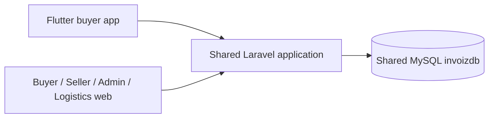

**Buyer mobile integration — 28 October 2026**

The Flutter buyer app from
`C:\Users\LENOVO\OneDrive\Desktop\Invoiz e-commerce\Invoiz buyer acc\frontend`
is integrated under `buyer_mobile`. The original folder was not modified.
The standalone backend, `.env`, SQL dump, nested Git repository, generated
build/cache/IDE folders and old testing workbooks were not imported. The root
Laravel application remains the sole backend. No migration or SQL dump was
executed and no existing customer/financial records were changed.



All 72 application models and the Sanctum token model use the default
connection. Mobile checkout creates the existing order, item, payment,
ledger, delivery and pickup-request records used by the other roles.
Role and record-ownership permissions remain enforced.

**Preserved features and integration work**

All 18 supplied screens remain, along with their shared Flutter layout,
theme, logo, Android/web projects and unchanged dependency lockfile.
`buyer_mobile/api-contract.json` records all 45 original method/path entries,
their integrated destinations, and the additional checkout-preview endpoint.

| Feature / source screens | Integration |
| --- | --- |
| Splash and home | Same catalog/categories; guest browsing retained. Protected badge requests are skipped for guests. |
| Registration, verification and login | `/api/mobile/buyer/*` uses the existing `users` table, website OTP fields and shared attempt/cooldown keys. No second verification table. |
| Buyer approval | Mobile registration remains pending after verification. Main Admin → Buyers has Approve/Reject actions and sends the existing decision email. Approval requires verified email and administrator permission. Website registration policy is unchanged. |
| Existing accounts and restoration | Existing approved website credentials work. Sanctum tokens use the same database; restoration rechecks activity. Local token storage is namespaced by backend URL. |
| Product list and details | Search, categories, price/rating/discount sorting, sale filters, galleries, specifications, reviews, stock and variations. Running sales use shared seller-sale calculations. |
| Images | Stored paths use the shared server's `/storage`; local absolute URLs are rebased for the configured device backend. Same-origin web hosting avoids image CORS issues. |
| Recently viewed | Device-local history remains; it is not another account/order database. |
| Favorites | Shared favorite rows; optional bearer authentication supplies the buyer's favorite state on public product reads. |
| Storefront, reviews and following | Existing store API plus idempotent POST/DELETE follow routes and authenticated follow state. |
| Cart | Shared cart/header/item records. PUT is supported alongside PATCH. Selected line IDs reach checkout and unselected lines are retained. |
| Addresses | Existing address controllers, normalization, ownership and default-address rules. |
| Checkout, vouchers and COD | Preview and submission share one quote calculation for selected items, variants, sale prices, shipping per seller and claimed vouchers. Coupon tiles collect vouchers; checkout submits claim IDs while keeping internal codes hidden. Free-shipping vouchers work. |
| Orders, cancellation and rating | Same orders/status history/payments/deliveries. Mobile responses include line totals and product images. Cancellation supplies the required reason and retains shared stock/refund rules. |
| Chat and badges | `/api/conversations*` aliases use the existing controller and message tables. Seller replies/unread state use the same records; foreign threads are rejected. |
| Notifications | Shared activity-derived inbox, unread count and original mobile per-ID read path scoped to the buyer. |
| Account/profile | Multipart/PUT profile routes preserve names, phone, address fields, bio, avatar, ID upload and password changes. Upload type/size checks apply. Profile updates cannot change privilege fields. |
| Seller application/status API | Original entry points are retained. Submission delegates to the existing website handler and complete business/document rules. Status/profile read the same seller row. |

The original Flutter source contains no full seller-management screens; its
old README described some capabilities absent from those screens. Full Seller
Center functionality stays in the website. Absent seller-management, returns,
password-reset and Google-login screens are not claimed as new mobile features.

Public reviews now allowlist buyer display fields, OTP fields are hidden from
model JSON, and conversation sender/store summaries exclude private account,
tax and document fields. This prevents unnecessary private data from reaching
the connected client. It does not resolve every earlier security-audit finding.

**Builds and connection configuration**

`INVOIZ_API_BASE_URL` is the only mobile API setting. It contains an HTTP(S)
URL ending in `/api`, not database credentials. Android emulator defaults to
`http://10.0.2.2:8000/api`. Web builds hosted by Laravel use its origin. A real
phone needs the website's reachable HTTPS URL or an explicitly configured
reachable development address. Only localhost was found locally; no public
URL, tunnel or domain was created.

From the repository root:

```powershell
powershell -NoProfile -ExecutionPolicy Bypass -File buyer_mobile/scripts/Build-Web.ps1
powershell -NoProfile -ExecutionPolicy Bypass -File buyer_mobile/scripts/Build-Android.ps1
```

Web preview: `http://127.0.0.1:8000/buyer-app/`, with generated output in
Git-ignored `public/buyer-app/`. Debug APK:
`buyer_mobile/build/app/outputs/flutter-apk/app-debug.apk`. Flutter build/cache
files are ignored. Android Internet permission is included; debug builds
permit local HTTP. Production signing/distribution is a separate deployment
task. The supplied project has no iOS files.

Both scripts accept `-ApiBaseUrl https://YOUR-WEBSITE/api`. See the app README
for phone instructions. Changing native API addresses requires rebuilding
and signing in again. Keep Laravel database credentials on the server.

**Verification and limits**

- The connection diagnostic verifies MySQL `invoizdb`, all 72 application
  models, API token storage and the ten core tables.
- Isolated backend tests verify every recorded mobile route has an implemented
  handler. They cover OTP replay/expiry/attempt limits, admin-only approval,
  website credentials, suspension, uploads, addresses, cart/web synchronization,
  selected checkout, shipping groups, discounts/free shipping, ownership,
  review privacy, follows/favorites, chat, notifications, seller applications,
  cancellation, ratings and sale/gallery responses.
- Flutter tests cover API origin/auth headers, uploads, server errors, session
  persistence/revocation, image URLs, sale/voucher decoding, selected line IDs,
  checkout totals and splash behavior.
- Edge browser mutation checks use a temporary SQLite database containing only
  synthetic accounts while running the same Laravel code. The harness redirects
  API requests to that isolated server. Login, variation selection, cart,
  vouchers and COD checkout were exercised without real purchases. Read-only
  requests also checked the running MySQL API and preview entry point.
- Android debug APK and web builds compile. Legacy analyzer lint/deprecation
  findings remain in imported screens; they are not all claimed as repaired.
- Real SMTP delivery, phone connectivity, native picker interaction and signed
  distribution require device/deployment testing. API uploads are covered in
  isolated tests. The complete existing MySQL suite needs its dedicated test DB.

No commit/push or change to the original mobile folder was performed.
The buyer app was subsequently organized under `buyer_mobile`; buyer run/build commands are included in `run.txt`.
