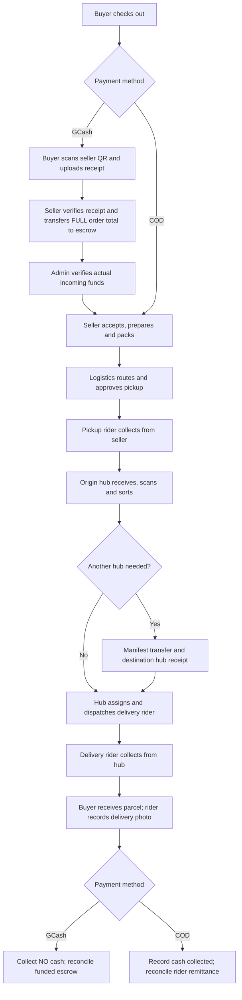
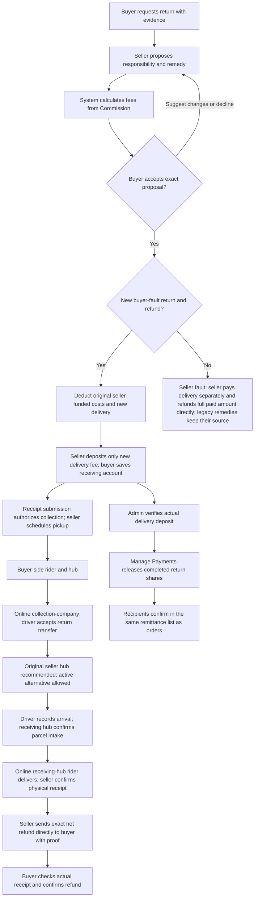
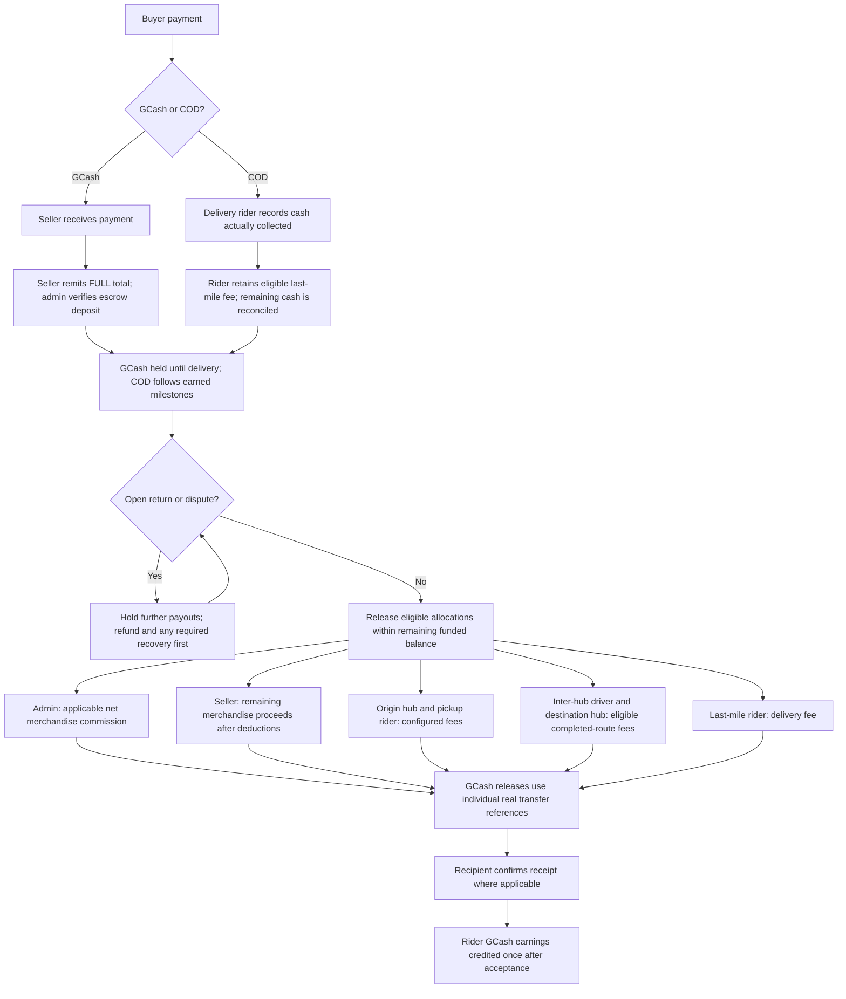
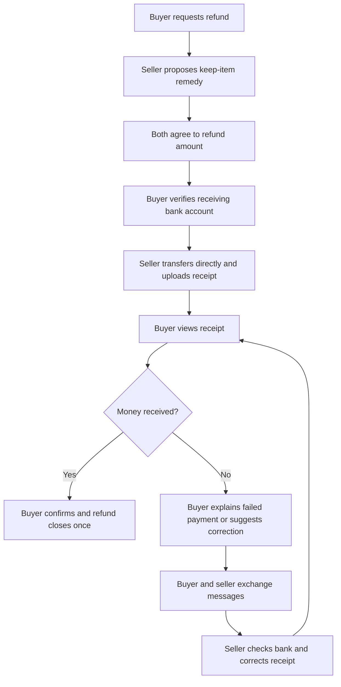
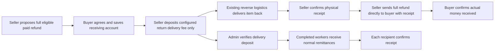

# Orders, returns and earnings

Updated November 9, 2026. Open `/return-center` while signed in to see the cases and actions allowed for your account. Sellers propose resolutions in **Seller → Returns & Refunds**. New cases use automatic Commission service rates and mutual buyer/seller agreement, with seller-deposited delivery escrow and a direct seller refund for new buyer-fault returns. Seller-fault remedies retain their existing separate-payment process. Riders also have **Home / Deliveries → Return jobs** (rider app 1.0.7 build 9), and inter-hub drivers have **Home → Return transfers** in the rider app. See the [current UI guide](return-refund-ui-guide.html).

## 1. Ordering

GCash cannot advance just because a receipt was uploaded. Admin must confirm the seller's full escrow deposit. A fully refunded payment cannot restart fulfillment. Each seller parcel has its own custody and allocations.

## 2. Returns and refunds

New buyer-fault example: PHP 4,599 item value - PHP 569.90 original seller-funded costs - PHP 160 new return = PHP 3,869.10 direct refund. Original buyer-paid shipping of PHP 50 is credited when calculating original cost recovery. Only PHP 160 is deposited into delivery escrow. Compensation is retained cost recovery, not another payout. No admin customer approval is needed; actual delivery cash must be verified before worker payouts.

Destination selection recommends the original seller-side hub but excludes suspended hubs and companies. A different active receiving hub may be used. After funding, substitutions must preserve the agreed service budget and cannot reassign already earned/paid work. Driver arrival is separate from receiving-hub confirmation, and no cash is collected.

Already accepted/paid contracts keep their recorded terms. The following older funding details apply to those cases and legacy or other remedies. See the current UI guide for the new buyer-fault buttons.

Rules implemented:

- Standard item returns use the configured return window, default 7 days, and the actual merchandise amount paid after voucher allocation. Original completed delivery is not automatically refunded through the standard item-return form.
- An open return freezes unreleased order payouts. Buyer and seller agree to the exact resolution and automatic fee snapshot. Admin verifies transfers, rather than approving normal responsibility or choosing service fees.
- Physical receipt, stock restoration, refund transfer and buyer confirmation are separate events. Damaged stock is not automatically put back on sale. A zero-cash-value return closes without inventing a transfer.
- Repeated receipt/refund actions cannot restore stock or refund money again. Seller ownership is checked per parcel, including older shared orders.
- Unpaid failed COD delivery creates no buyer cash refund. It follows the existing rider → hub → seller return path. Seller confirmation can cancel the order once all its parcels are returned or cancelled.
- A cancelled prepaid order queues a refund review including unused shipping. It requires no second physical return or stock restoration. Payment-only adjustments do not consume purchased return quantities.
- Completed logistics work remains payable. Merchandise refunds reduce the seller's remaining allocation and reverse the applicable merchandise commission. When those funds were already paid out, or are insufficient to cover earned logistics fees, admin must verify recovery funding first.
- Reverse transport uses its own verified return-fee payment and service allocations. Required riders and hubs earn only for independently confirmed work and must accept remittances before earnings are counted. No return fee is deducted from the held refund or seller proceeds.

Support can review a rejected request through the existing Help/complaint process. A complaint decision alone does not transfer money. Receiving-account details and exceptional refund scope still need verification by the responsible staff.

## 3. Money, escrow and earnings

The configured allocation formula is shared by settlement and escrow. Default fees are origin hub ₱30, pickup rider ₱30 per purchased unit, inter-hub driver ₱20 when eligible, destination hub ₱30 when eligible, and last-mile rider ₱50 unless an applicable delivery fee overrides it. Default platform commission is 10% of net merchandise; category/configured rates may differ. Driver vehicle allowances have a separate existing workflow.

For GCash, every role is paid from escrow with its own recorded transfer reference. COD retains its existing cash and wallet/remittance process; it is excluded from GCash batch releases. Rider GCash earnings appear only after the rider accepts the incoming payout. The release ceiling accounts for actual refunds and verified recovery deposits.

**Transfers remain manual.** The app records private evidence, references, verification and balances; it does not move money through a bank or GCash API. Admin must verify incoming recovery funds and actual outgoing refunds before recording them. Buyer confirmation means the money appeared in the buyer's receiving account.

## Verification and existing records

The implementation and validation notes are in [the return/refund review](../audits/2026-11-05/return-refund-workflow.md).

Existing order #74 was queued for refund review because it was cancelled with a GCash receipt but had no refund case. No stock or money was changed by that repair. Existing order #73 is flagged because it reached confirmed status without a funded escrow deposit; further fulfillment and release are blocked pending seller/admin funding verification. One older closed return has no new payment-proof/confirmation history and is explicitly labelled a legacy record rather than treated as verified receipt.

Orders and return-service payouts share **Manage Payments** and the recipient's regular **Remittances** list. Return rows are labelled by return number and service. Admin confirms the incoming escrow once and releases completed shares; each recipient confirms actual receipt. Return services no longer require their own receiving-account form or outgoing receipt upload. Accepted return pay is included in normal earnings totals/history. The underlying budget limits and source IDs prevent duplicate payouts or spending customer-refund funds on service fees.

## Keep-item refunds (refund only / partial refund)

No transport work or refund-funding deposit is created. Receipt submission is pending until the buyer confirms actual receipt. Current receipt identifiers prevent stale confirmation; prior receipt revisions and receiving snapshots remain private. See the [UI guide](return-refund-ui-guide.html#keep-item).

Seller-fault physical returns use the same custody and delivery escrow as buyer-fault returns, with no customer-refund deductions:

Example: PHP 4,599 item + PHP 50 original paid shipping = PHP 4,649 direct buyer refund. Seller pays PHP 160 reverse delivery separately when the Commission route totals that amount. Shipping is allocated to this seller and returned quantity; free shipping is not reimbursed again. Original already-earned order shares remain recorded. No customer refund recovery is deposited into platform escrow. Existing funded legacy cases preserve their recorded source.
