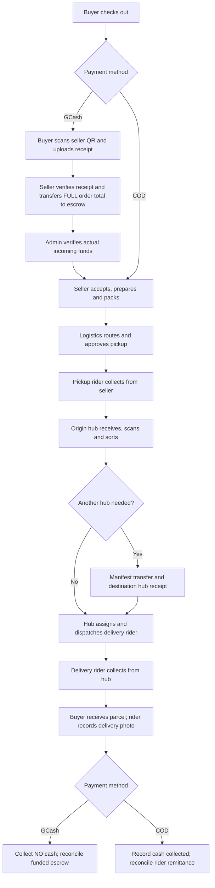
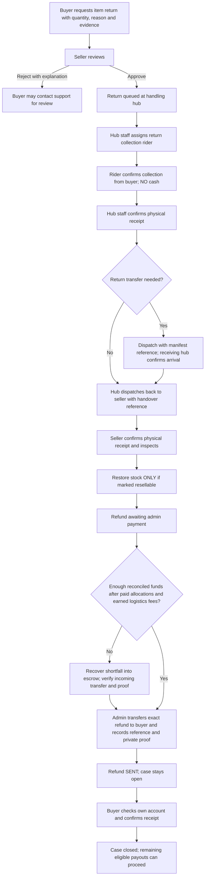
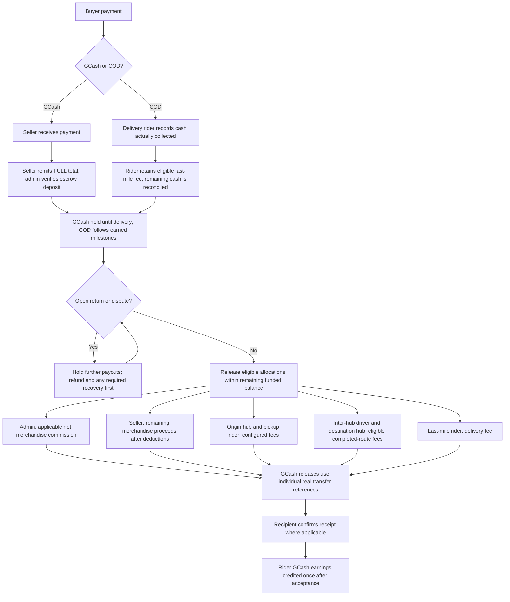

# Orders, returns and earnings

Updated November 5, 2026. Open `/return-center` while signed in to see the cases and actions allowed for your account. Seller approval remains in **Seller → Returns & Refunds**. Riders also have **Dashboard → Return collections** in the rider app.

## 1. Ordering

GCash cannot advance just because a receipt was uploaded. Admin must confirm the seller's full escrow deposit. A fully refunded payment cannot restart fulfillment. Each seller parcel has its own custody and allocations.

## 2. Returns and refunds

Rules implemented:

- Standard item returns use the configured return window, default 7 days, and the actual merchandise amount paid after voucher allocation. Original completed delivery is not automatically refunded through the standard item-return form.
- An open return freezes unreleased order payouts. Admin dispute approval creates a pending payment review, rather than claiming a transfer happened.
- Physical receipt, stock restoration, refund transfer and buyer confirmation are separate events. Damaged stock is not automatically put back on sale. A zero-cash-value return closes without inventing a transfer.
- Repeated receipt/refund actions cannot restore stock or refund money again. Seller ownership is checked per parcel, including older shared orders.
- Unpaid failed COD delivery creates no buyer cash refund. It follows the existing rider → hub → seller return path. Seller confirmation can cancel the order once all its parcels are returned or cancelled.
- A cancelled prepaid order queues a refund review including unused shipping. It requires no second physical return or stock restoration. Payment-only adjustments do not consume purchased return quantities.
- Completed logistics work remains payable. Merchandise refunds reduce the seller's remaining allocation and reverse the applicable merchandise commission. When those funds were already paid out, or are insufficient to cover earned logistics fees, admin must verify recovery funding first.
- Reverse collection and manual return manifests do not automatically generate a second set of forward-delivery earnings. Any extra reverse-transport costs require a separately agreed operational arrangement.

Support can review a rejected request through the existing Help/complaint process. A complaint decision alone does not transfer money. Receiving-account details and exceptional refund scope still need verification by the responsible staff.

## 3. Money, escrow and earnings

The configured allocation formula is shared by settlement and escrow. Default fees are origin hub ₱30, pickup rider ₱30 per purchased unit, inter-hub driver ₱20 when eligible, destination hub ₱30 when eligible, and last-mile rider ₱50 unless an applicable delivery fee overrides it. Default platform commission is 10% of net merchandise; category/configured rates may differ. Driver vehicle allowances have a separate existing workflow.

For GCash, every role is paid from escrow with its own recorded transfer reference. COD retains its existing cash and wallet/remittance process; it is excluded from GCash batch releases. Rider GCash earnings appear only after the rider accepts the incoming payout. The release ceiling accounts for actual refunds and verified recovery deposits.

**Transfers remain manual.** The app records private evidence, references, verification and balances; it does not move money through a bank or GCash API. Admin must verify incoming recovery funds and actual outgoing refunds before recording them. Buyer confirmation means the money appeared in the buyer's receiving account.

## Verification and existing records

The implementation and validation notes are in [the return/refund review](../audits/2026-11-05/return-refund-workflow.md).

Existing order #74 was queued for refund review because it was cancelled with a GCash receipt but had no refund case. No stock or money was changed by that repair. Existing order #73 is flagged because it reached confirmed status without a funded escrow deposit; further fulfillment and release are blocked pending seller/admin funding verification. One older closed return has no new payment-proof/confirmation history and is explicitly labelled a legacy record rather than treated as verified receipt.
